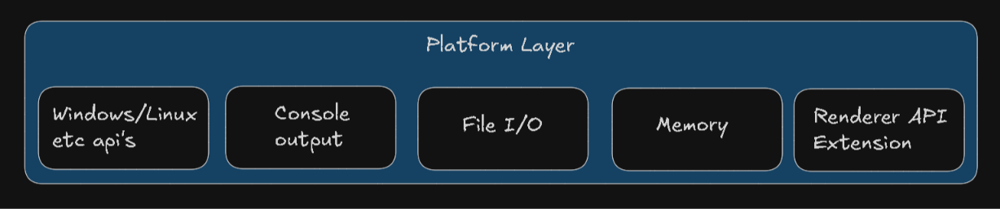
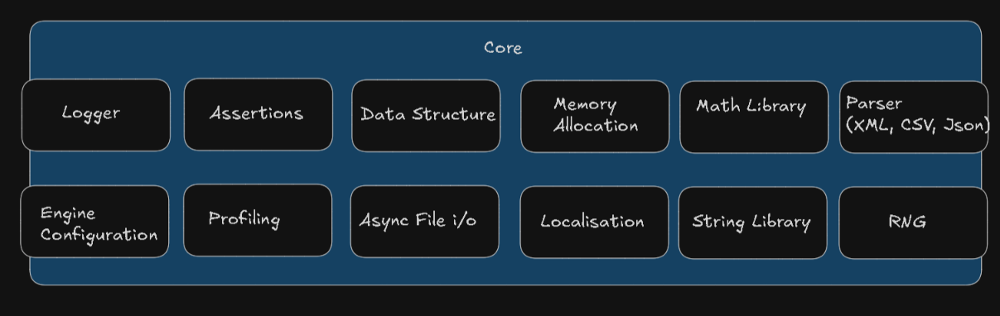
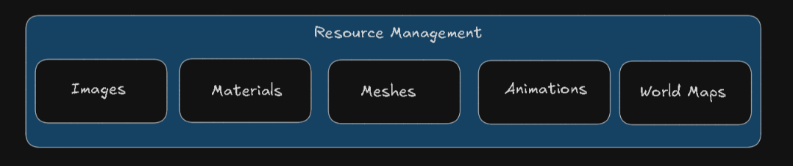
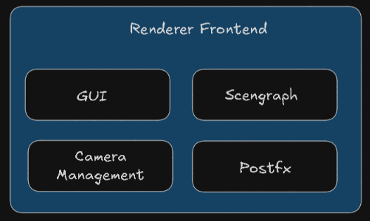
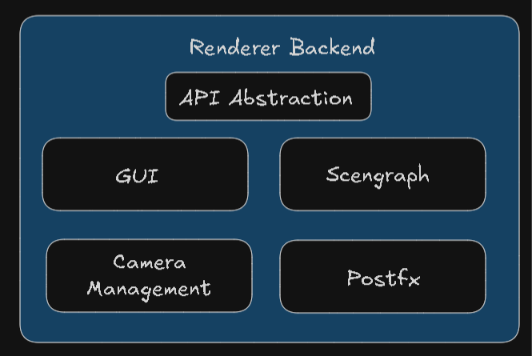
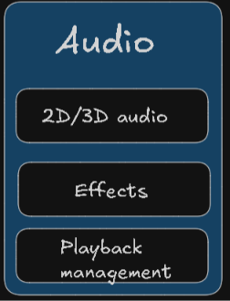
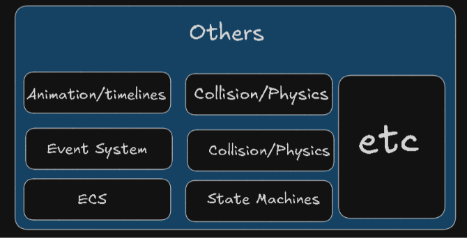

# Engine Architecture

## Platform Layer

## Core 

## Resource Management

<table>
  <tr>
    <th align="center">Renderer Frontend    </th>
    <th align="center">Renderer Backend</th>
    <th align="center">Audio</th>
  </tr>
  <tr>
    <td align="center"></td>
    <td align="center"></td>
    <td align="center"></td>
  </tr>
</table>

## Others 
